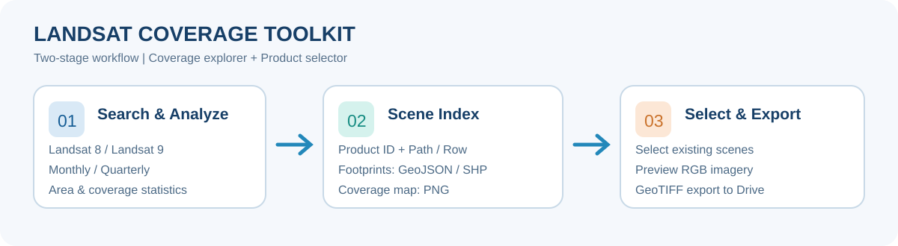
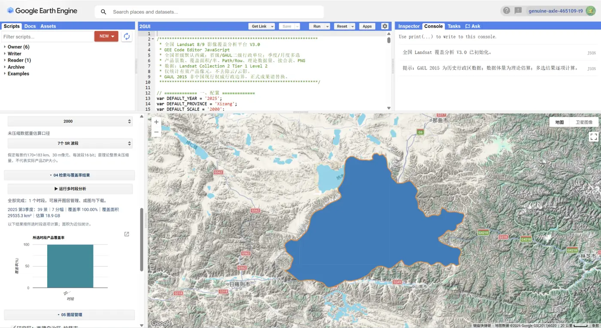
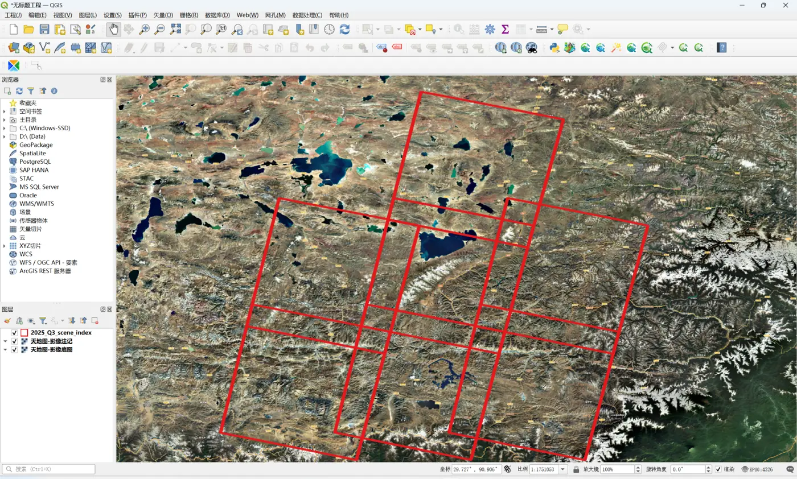

<div align="center">

# 🛰️ Landsat Coverage Toolkit

### Landsat 8/9 影像覆盖检索、接合表生成与选景导出工具
### Landsat 8/9 Coverage Explorer & Scene Selection Toolkit

**Google Earth Engine · Landsat Collection 2 · Interactive GUI**

[🇨🇳 中文](README_CN.md) · [🇺🇸 English](README.md) · [中英同页](#中文说明) · [使用教程 / Guide](docs/usage.md) · [Coverage Explorer](gee/coverage_explorer.js) · [Product Selector](gee/product_selector.js)

  

</div>

> **Beta / 测试版**：已进行 JavaScript 基础语法检查，但尚未在实际 GEE 账户中完成全流程验证。欢迎在 Issues 中反馈错误。  
> **Data**: Landsat Collection 2 Tier 1 Level-2; the coverage metric **does not remove clouds or cloud shadows**.



<a id="中文说明"></a>
## 🇨🇳 中文说明

本项目包含两个独立的 Google Earth Engine（GEE）交互式脚本，用于 Landsat 8/9 产品覆盖情况检索分析，以及从已有影像接合表中按产品编号选择与导出影像。

### 核心功能

| 模块 | 功能 |
| --- | --- |
| **影像覆盖分析** [`coverage_explorer.js`](gee/coverage_explorer.js) | Landsat 8、Landsat 9 或合并检索；选择年份、全国省级行政区及 GAUL 第二级单位；季度/月度多选；逐时段覆盖率、覆盖面积、景数、WRS Path/Row 数量和理论数据量 |
| **成果展示与导出** | 图层折叠管理；覆盖图 PNG；逐景矢量接合表 GeoJSON / SHP；产品属性 CSV |
| **已有产品选景** [`product_selector.js`](gee/product_selector.js) | 读取含 `PRODUCT_ID` 字段的 GEE 矢量 Asset，或粘贴产品 ID；分页勾选、预览、按波段输出 GeoTIFF |

**默认设置：** 西藏自治区 / Landsat 8 / 2025 年 / 季度多选。计算按选定时段依次进行，尽量降低 Earth Engine 并发聚合负担。

### 快速开始

1. 打开 [Google Earth Engine Code Editor](https://code.earthengine.google.com/)，登录并配置 Earth Engine Cloud Project。
2. 复制 [影像覆盖分析脚本](gee/coverage_explorer.js) 到新建 GEE 脚本中，点击 **Run**。
3. 选择省份、数据源、年份、一个或多个季度/月度，运行分析。
4. 在「图层管理」查看覆盖图和场景接合表，在「下载」生成 PNG、GeoJSON、CSV 或 SHP 导出任务。
5. 若需选定已有产品，再运行 [产品选景脚本](gee/product_selector.js)，输入接合表 Asset 路径或产品 ID，并在 **Tasks** 手动启动 GeoTIFF 导出。

详细步骤、字段要求及常见问题见 [中英双语使用指南](docs/usage.md)。

### 二维码 / QR Code

<div align="center">


**扫码访问本仓库 / Scan to open the repository**

</div>

### 界面预览 / UI Preview

### GEE 影像覆盖分析界面 / GEE Coverage Explorer



*实际运行截图：2025 年第三季度产品覆盖率分析，折叠菜单、地图分布和统计结果。 / Actual GEE runtime screenshot showing the collapsible GUI, map and coverage summary.*

### QGIS 影像接合表成果 / QGIS Scene Footprints



*实际运行截图：2025 年第三季度影像接合表与底图叠加显示。 / Actual QGIS screenshot of Landsat scene footprints over imagery.*

> 以上为用户提供的真实操作截图，展示特定环境与统计结果，不代表所有区域或时段的运行效果。脚本仍为 Beta，尚未开展全面端到端测试。  
> These are real user-supplied screenshots from a specific environment; the scripts remain Beta and are not exhaustively validated.

### 数据与统计口径

- **数据集：** `LANDSAT/LC08/C02/T1_L2` 和 `LANDSAT/LC09/C02/T1_L2`。
- **产品覆盖率：** 统计期内至少一次存在非 Fill 像元的面积占研究区面积比例；**不做云、云影剔除**，不能解读为无云影像覆盖率。
- **行政区边界：** 默认使用 FAO GAUL 2015 的 `level1`、`level2`。非现行中国权威行政区划；部分地市仍显示数据源原名。
- **数据量：** 依照整景尺寸、波段数和位深计算的**理论未压缩估算值**，非实际 ZIP/TAR 文件大小，也不等于实际下载流量。
- **接合表：** 为影像**逐景 footprint**，同一路径行号在不同日期会重复出现。
- **产品导出：** GEE 输出的 GeoTIFF 不等同于 USGS 官方归档整包。需要原版产品请使用 [USGS EarthExplorer](https://earthexplorer.usgs.gov/)。
- **面积与资源：** 分辨率为分析尺度，统计面积为近似结果；出现 quota 错误时可提高尺度数值或减少时段。

<a id="english"></a>
## 🇬🇧 English

This repository provides two standalone Google Earth Engine JavaScript GUI tools for Landsat 8/9 imagery coverage exploration and selection/export of previously indexed scenes.

### Features

- **Coverage Explorer:** Select Landsat 8, Landsat 9 or both; choose a year, province or GAUL second-level administrative unit; select multiple quarters or months; summarize scene counts, unique WRS Path/Row combinations, approximate footprint coverage, and estimated uncompressed data volume.
- **Visualization & outputs:** Collapsible panels, map layers, PNG coverage snapshots, GeoJSON/SHP scene footprints, and CSV scene metadata.
- **Product Selector:** Load a GEE FeatureCollection asset with a `PRODUCT_ID` field or paste product IDs; choose individual scenes, preview RGB, and create GeoTIFF export tasks.

### Quick start

Open the [Earth Engine Code Editor](https://code.earthengine.google.com/), copy [`gee/coverage_explorer.js`](gee/coverage_explorer.js) into a new script, and click **Run**. The initial configuration selects Xizang/Tibet, Landsat 8, year 2025, and quarter selection. Use [`gee/product_selector.js`](gee/product_selector.js) for individual product selection and export. See the [bilingual guide](docs/usage.md) for details.

### Important limitations

Coverage is defined by non-Fill product pixels **without cloud masking**. FAO GAUL 2015 boundaries are historical and not authoritative for current administrative reporting. Data sizes are theoretical **uncompressed estimates**, not download package sizes. Exported GEE GeoTIFFs are **not equivalent to original USGS Level-2 product archives**. Runtime behavior depends on Earth Engine quotas and permissions.

## 项目结构 / Structure

```text
Landsat-Coverage-Toolkit/
├── README.md
├── .gitignore
├── assets/
│   ├── workflow.svg
│   ├── gee-runtime.webp
│   ├── qgis-scene-index.webp
│   └── gui-preview.svg
├── docs/
│   └── usage.md
└── gee/
    ├── coverage_explorer.js
    └── product_selector.js
```

## 📬 Connect / 联系与交流

<table align="center">
  <tr>
    <th width="33%">WeChat Official Account<br>微信公众号：测绘地信</th>
    <th width="33%">WeChat Mini Program<br>微信小程序：测绘地信</th>
    <th width="33%">Knowledge Planet<br>知识星球：测绘地理信息共享中心</th>
  </tr>
  <tr>
    <td align="center" valign="middle"></td>
    <td align="center" valign="middle"></td>
    <td align="center" valign="middle"></td>
  </tr>
</table>

<div align="center">

[](https://github.com/zhangyhrs)

</div>

## 贡献与许可 / Contributing & License

欢迎通过 GitHub Issues 反馈问题、提供可复现的运行日志与改进建议。  
Issues and reproducible bug reports are welcome.

**License:** [MIT License](LICENSE) (Copyright © 2026 Zhang Y.H.).

---
<div align="center">

Maintained by [zhangyhrs](https://github.com/zhangyhrs) · [Repository](https://github.com/zhangyhrs/Landsat-Coverage-Toolkit)

</div>
