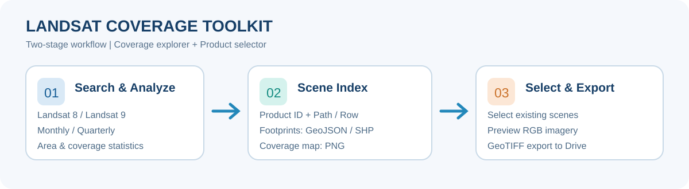
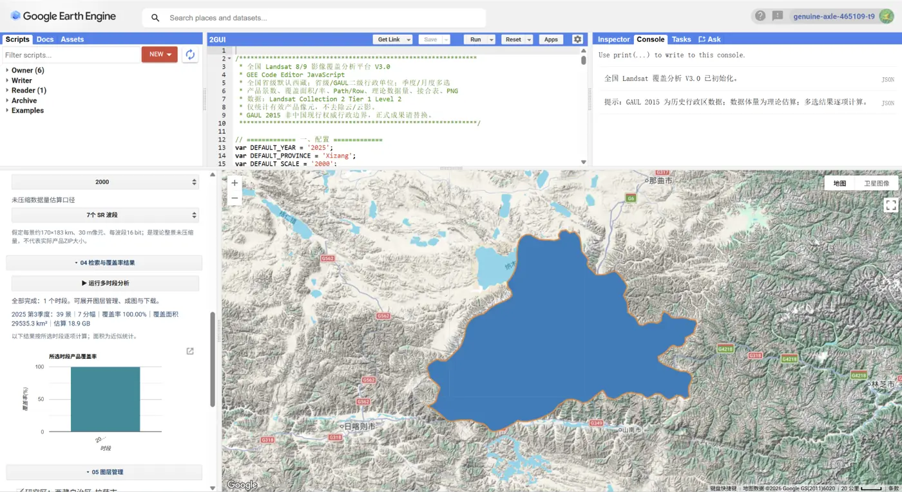
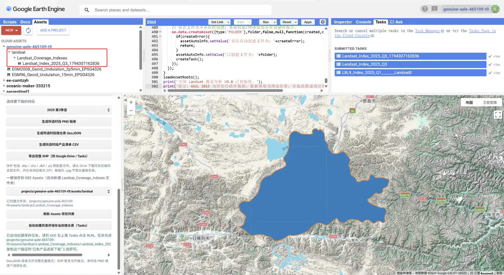
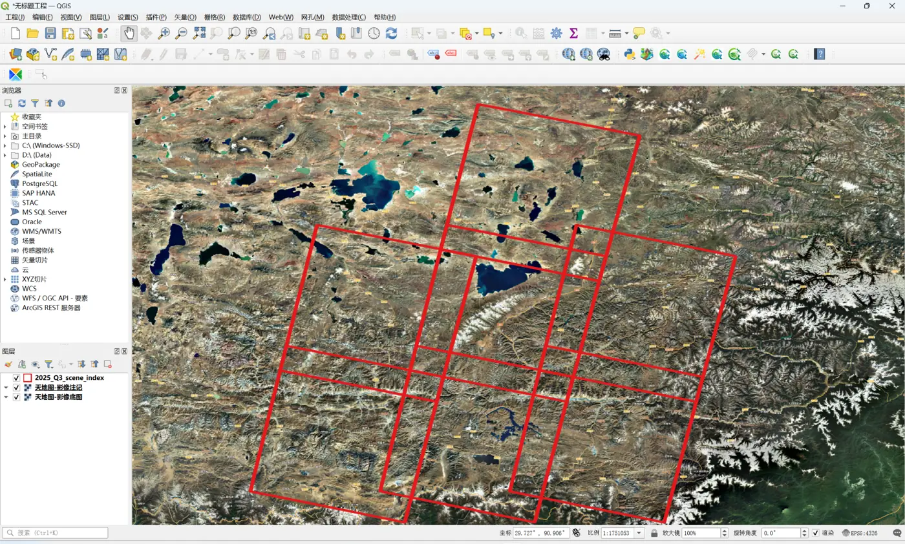

<div align="center">

# 🛰️ Landsat Coverage Toolkit

### Landsat 8/9 遥感影像覆盖检索与已有产品选景下载工具

**Google Earth Engine · JavaScript GUI · Landsat Collection 2**

[🇺🇸 English](README.md) · **🇨🇳 中文** · [操作指南](docs/usage.md) · [代码目录](gee/)


</div>

---

## 项目简介

**Landsat Coverage Toolkit** 面向 Landsat 8/9 遥感影像产品的检索、覆盖情况统计及选景导出，包含两套独立的 GEE Code Editor 脚本：

1. **覆盖分析工具**：根据年份、卫星和行政区范围，按季度或月份多选统计产品景数、覆盖范围、面积、独立 WRS Path/Row 分幅及理论数据量。
2. **选景导出工具**：自动读取 `Landsat_Coverage_Indexes` 文件夹中的接合表，也可输入 Asset ID 或产品编号，逐景勾选、浏览影像，并创建 Google Drive GeoTIFF 导出任务。



### 检索阶段整景云量筛选（V3.1）

覆盖分析 GUI 的 **01 数据源与时间** 新增 **整景云量上限**，可选择“不限、≤80%、≤50%、≤30%、≤20%、≤10%、≤5%、≤0%”。筛选基于 USGS 产品元数据 `CLOUD_COVER`，先过滤影像集合，再计算产品景数、WRS Path/Row 分幅数、空间覆盖率、接合表及数据量估算。分析结果会显示**筛选前景数 → 筛选后景数**。此选项是**整景筛选，不是逐像元去云**；覆盖区中仍可能有云、积雪和云影。保存到 GEE Assets 的接合表同样只包含筛选后产品。

## 核心功能

| 功能 | 说明 |
| --- | --- |
| 影像产品检索 | Landsat 8、Landsat 9、Landsat 8 + 9 |
| 时间筛选 | 年份、季度多选、月份多选 |
| 行政区选择 | 全国省级单位，默认西藏自治区；可选择 GAUL 第二级行政单位 |
| 覆盖率分析 | 产品有效（非 Fill）像元覆盖率、覆盖面积、产品景数 |
| 分幅统计 | 独立 WRS Path/Row 数量 |
| 数据量统计 | 按假定场景尺寸、波段数及位深估算的未压缩体量 |
| 接合表 | 逐景影像足迹矢量，可预览并导出 GeoJSON / SHP |
| 图件与清单 | 覆盖图 PNG、产品信息 CSV |
| 选择与导出 | 从接合表 Asset 或产品 ID 中挑选影像，导出 GeoTIFF |

## 界面预览

### GEE 覆盖率统计界面



### GEE Assets 自动保存接合表（实际运行截图）



保存任务在 GEE Tasks 中运行完成后，升级后的 [选景下载 GUI](gee/product_selector.js) 可以自动发现 `Landsat_Coverage_Indexes` 文件夹中的接合表，直接选择和加载，不用手动复制完整 Asset ID。

*实际运行截图：2025 年第三季度 Landsat 产品覆盖率分析，含一级折叠菜单、统计结果和空间覆盖分布。*

### QGIS 影像接合表成果



*实际运行截图：2025 年第三季度 Landsat 逐景影像接合表叠加遥感影像底图。*

> 以上均为用户提供的真实运行截图。图中结果仅对应当时的参数和环境；项目代码仍为 Beta，尚未进行全面端到端测试。

## 快速使用

1. 在 [Google Earth Engine Code Editor](https://code.earthengine.google.com/) 中登录，并设置可使用的 Google Cloud Project。
2. 新建脚本，复制 [`gee/coverage_explorer.js`](gee/coverage_explorer.js) 的全部代码，点击 **Run**。
3. 选择年份、影像数据源、省级行政区及一个或多个季度、月份，运行覆盖率统计。
4. 在图层管理、下载菜单中查看覆盖分布、导出 PNG、GeoJSON、SHP 或 CSV。
5. 需要选择已有产品时，运行 [`gee/product_selector.js`](gee/product_selector.js)，从项目中选择已保存的接合表（或输入 GEE Asset 路径、粘贴 `LANDSAT_PRODUCT_ID`），按景勾选并启动 GeoTIFF 导出。

更多说明参见 [使用指南](docs/usage.md)。


> **新增整景云量筛选（V1.2）：** 已有产品选景 GUI 支持按接合表的 `CLOUD_PCT` 属性设置云量上限（80%、50%、30%、20%、10%、5%、0%），并在每景产品 ID 旁显示云量。该指标为**整景云量**，并非行政区内云量；直接粘贴产品 ID 模式暂不应用筛选。

## 数据来源和适用范围

本项目使用 `LANDSAT/LC08/C02/T1_L2` 和 `LANDSAT/LC09/C02/T1_L2`。

- **覆盖率统计不是无云率统计**：云、云影、积雪不剔除，按非 Fill 像元判断产品覆盖情况。
- **历史边界提示**：默认边界为 FAO GAUL 2015，并非现行中国权威行政区划。用于正式业务成果前应核对或更换边界。
- **数据量为估算值**：不代表 USGS 官方 TAR/ZIP 产品包的实际大小。
- **产品导出区别**：GEE 导出的 GeoTIFF 不是 USGS 官方原始整包。需原始官方产品请使用 [USGS EarthExplorer](https://earthexplorer.usgs.gov/)。
- **计算资源限制**：如果出现 `Too many concurrent aggregations` 或容量超限，建议减少时段、提高统计尺度数值。
- **版本状态**：目前为 Beta 版本，尚未完成完整 GEE 端到端验证。

## 目录结构

```text
Landsat-Coverage-Toolkit/
├── README.md                  # 双语总览
├── README_CN.md               # 中文项目介绍
├── LICENSE
├── assets/
│   ├── workflow.svg
│   ├── gee-asset-export-runtime.webp
│   ├── gee-runtime.webp
│   ├── qgis-scene-index.webp
│   └── gui-preview.svg
├── docs/
│   └── usage.md
└── gee/
    ├── coverage_explorer.js   # 覆盖率检索分析
    └── product_selector.js    # 已有产品选景导出
```

## 📬 Connect · 联系与交流

<table align="center">
  <tr>
    <th width="33%">WeChat Official Account<br>微信公众号：测绘地信</th>
    <th width="33%">WeChat Mini Program<br>微信小程序：测绘地信</th>
    <th width="33%">Knowledge Planet<br>知识星球：测绘地理信息共享中心</th>
  </tr>
  <tr>
    <td align="center" valign="middle"></td>
    <td align="center" valign="middle"></td>
    <td align="center" valign="middle"></td>
  </tr>
</table>

<div align="center">

[](https://github.com/zhangyhrs)

</div>

## 许可和反馈

项目采用 [MIT License](LICENSE)。欢迎通过 [GitHub Issues](https://github.com/zhangyhrs/Landsat-Coverage-Toolkit/issues) 反馈使用问题和完善建议。

**作者：** Zhang Y.H.

